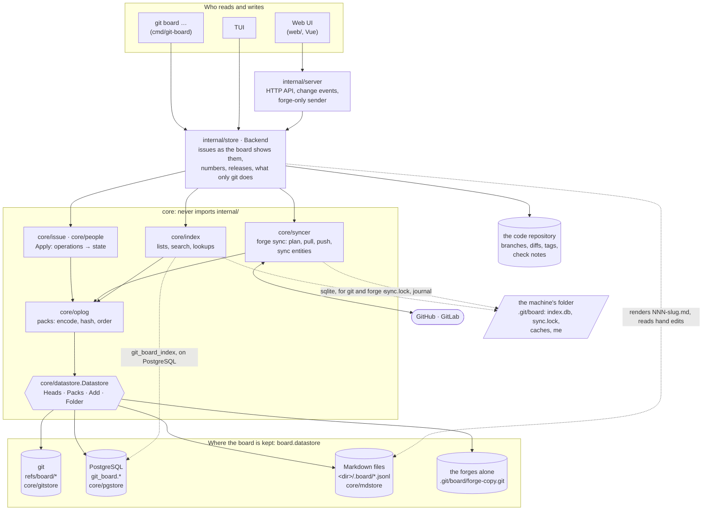
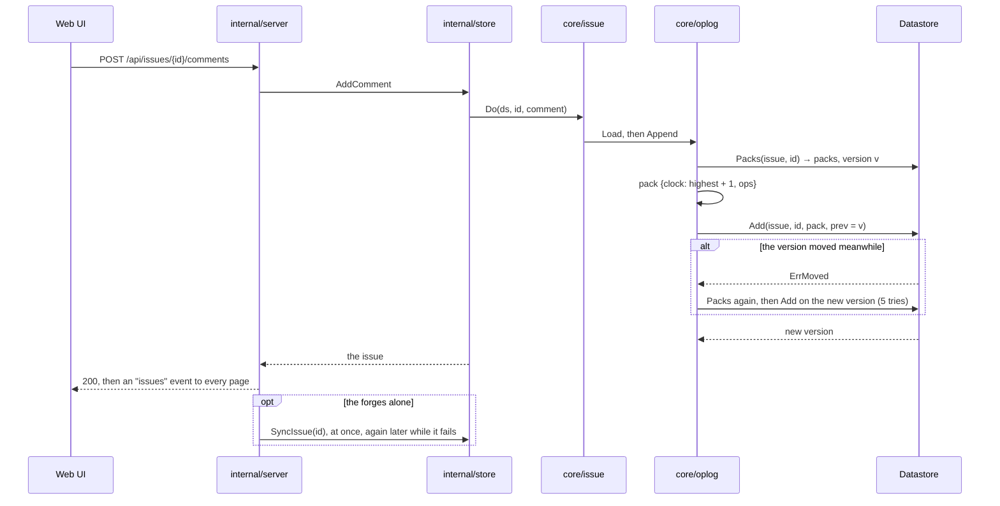

# How the data flows

Every reader and every writer of the board goes through the same layers,
whatever keeps the board. This page shows them, what each one owns, and
the path a write and a read take. [Storage](storage.md) gives the git
datastore's format; [ADR 0002](../adr/0002-datastores.md) gives why the
board is cut at the pack.

## The layers

| Layer | Owns | Knows nothing of |
|---|---|---|
| `internal/server` | the API, the pages' change events, the forge-only sender | how the board is stored |
| `internal/store` | the board as the pages show it: issues with their numbers and forges, releases, the counter; what only git does (pull, push, start over), refused elsewhere | the format of a pack |
| `core/issue`, `core/people` | an entity's state, folded from its operations (`Apply`) | where the operations are kept |
| `core/syncer` | forge sync; its bookkeeping (links, last seen, posted) is operations in `sync` entities | git: a forge sync runs the same on every datastore |
| `core/index` | lists, search and lookups, a cache brought up to the datastore before each query | the truth: it is never the source |
| `core/oplog` | packs: their bytes, their id (the git blob id of the bytes), their order (clock, then id) | where the packs are kept |
| `core/datastore` | the interface, and its errors: `ErrNotFound`, `ErrMoved`, `ErrMissing` | the packs' content |
| `core/gitstore`, `core/pgstore`, `core/mdstore` | the bytes, a version per entity, the compare-and-swap | operations |

## A write

- **One write is one pack**, added only if the entity is still at the
  version it was read at. Two writers never lose a write: the second
  reads again and writes on top.
- **A pack's id is computed by oplog**, not by the datastore, so an
  operation's id (`<pack id>:<index>`) is the same in every datastore, and
  so is every reference to it: an edit's target, a sync record, a marker
  on a forge.

## A read

- **A list or a search** asks the index. The index first reads the
  datastore's `Heads` (one version per entity), loads again only the
  entities whose version moved, and then answers from its tables.
- **One issue** is its packs, read from the datastore, sorted by oplog
  and folded by `core/issue`. `internal/store` keeps the folded issues
  per version, for a listing and for one issue alike (its page, its
  thread, a write): its packs are read each time, but an unchanged issue
  isn't folded twice.
- **The pages' change events** compare the datastore's heads every few
  seconds: a write from another clone, another machine or the command line
  reaches every open page.

## A forge sync

Sync reads and writes operations through the same datastore as everything
else: the issues it pulls into, and the `sync` entities that keep its
links and last seen values. It doesn't know where they are kept, so a
board in PostgreSQL syncs with GitHub exactly as one in git does. Its lock
and journal are in the machine's folder: two runs on one machine never
overlap. Two machines on one shared PostgreSQL board aren't kept apart yet,
and may create the same forge issue twice (issue #83): sync from one
machine.

## What lives where

| What | git | PostgreSQL | Markdown files | the forges alone |
|---|---|---|---|---|
| issues, people, sync and release records | `refs/board/<kind>/<id>` | `git_board.packs`, `git_board.entities` | `<dir>/.board/<kind>/<id>.jsonl`, one pack a line, and `<dir>/NNN-slug.md` rendered | a git copy in `.git/board/forge-copy.git`, filled by sync |
| project numbers | `refs/board/seq` | `git_board.counter` | the forges' own numbers only | the forges' own numbers only |
| the index | `.git/board/index.db` (sqlite) | `git_board_index.*`, shared | `.git/board/index.db` | `.git/board/index.db` |
| who you write as | git config `board.me` | git config `board.me` | git config `board.me` | git config `board.me` |
| sync lock and journal, caches | `.git/board/` | `.git/board/` | `.git/board/` | `.git/board/` |
| branches, diffs, tags, check notes | the code repository | the code repository | the code repository | the code repository |
| `.git-board.toml` | the code checkout | the code checkout | the code checkout | the code checkout |
