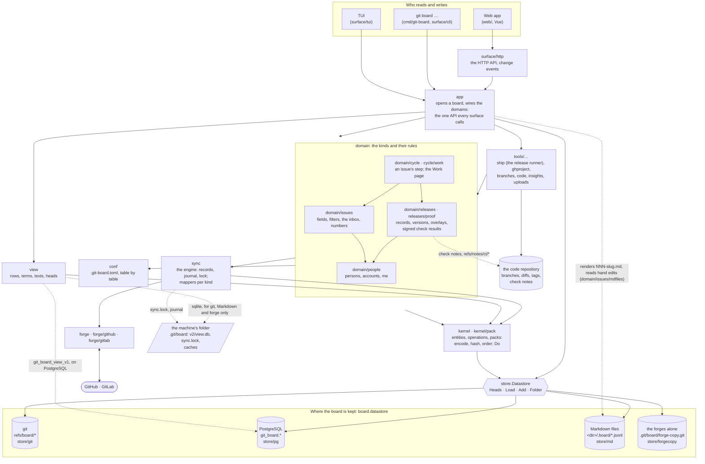

# How the data flows

Every reader and every writer of the board goes through the same layers,
whatever keeps the board. This page shows them, what each one owns, and
the path a write and a read take. [Storage](storage.md) gives the git
datastore's format; [ADR 0002](../adr/0002-datastores.md) gives why the
board is cut at the pack.

## The layers

v0.12 (ADR 0021, [the design](../rewrite/design.md#packages)): each
package imports only the ones below it, as `layers_test.go`'s table says.



| Layer | Owns | Knows nothing of |
|---|---|---|
| `surface/cli`, `surface/http`, `surface/tui` | the commands, the API and its change events, the terminal UI: adapters over `app` | how the board is stored, the rules of a kind |
| `app` | a board opened: its datastore, its view, its config, the domains wired; the one API every surface calls, its errors and exit codes; what only git does (pull, push, start over), refused elsewhere | the format of a pack |
| `tools/…` | apps over `app`: the release runner (`ship`), the GitHub Project bridge (`ghproject`), branches, the code repository, insights, uploads | the board's storage |
| `domain/issues`, `domain/people` | the `issue` and `person` kinds: their state folded from their operations, fields (ADR 0007), filters, the inbox, numbers | where the operations are kept |
| `domain/releases`, `releases/proof` | a release's record and its rules (one per commit), versions and tags, overlays; check results as signed lines in git notes, and the gate | registries, config repos and the forge, which `tools/ship` drives |
| `domain/cycle`, `cycle/work` | an issue's step from intent to verified, never stored; the Work page's rows | git and the forges, read in `app`; the experimental switch (ADR 0018) |
| `conf` | `.git-board.toml`: tables each domain registers, read once, written table by table, its schema version | what a table means |
| `sync` | the sync engine, generic over kinds: plan, pull, push; its records (links, last seen, posted) are operations in `sync` entities; the journal and the lock | git: a forge sync runs the same on every datastore |
| `forge`, `forge/github`, `forge/gitlab` | the forges' adapters, and their conformance suite (`forge/forgetest`) | the board |
| `view` | lists, search and lookups: the rows, terms and texts of every kind, brought up to the datastore's heads before each query (ADR 0009) | the truth: it is never the source |
| `kernel`, `kernel/pack` | entities and operations; packs: their bytes, their id (the git blob id of the bytes), their order (clock, then id); `Do`, a write with its compare-and-swap | where the packs are kept |
| `store` | the `Datastore` interface, its capabilities and errors: `ErrNotFound`, `ErrMoved` | the packs' content |
| `store/git`, `store/pg`, `store/md`, `store/forgecopy` | the bytes, a version per entity, the compare-and-swap | operations |

## A write

```mermaid
sequenceDiagram
  participant P as Web app
  participant S as surface/http
  participant A as app
  participant I as domain/issues
  participant K as kernel
  participant D as Datastore
  P->>S: POST /api/issues/{id}/comments
  S->>A: Comment
  A->>I: Comment(id, body)
  I->>K: Do(id, decide)
  K->>D: Load(issue, id) → packs, version v
  K->>I: decide(the issue at v) → operations
  K->>K: pack {clock: highest + 1, ops}
  K->>D: Add(issue, id, pack, prev = v)
  alt the version moved meanwhile
    D-->>K: ErrMoved
    K->>D: Load again, decide again, Add on the new version (5 tries)
  end
  D-->>K: new version
  K-->>A: the issue; the view's row replaced (write-through)
  A-->>S: the issue
  S-->>P: 200, then an event to every page
  opt the forges alone
    A->>A: the issue queued for the forge, sent at once, again later while it fails
  end
```

- **One write is one pack**, added only if the entity is still at the
  version it was read at. Two writers never lose a write: the second
  reads again, decides again, and writes on top.
- **A pack's id is computed by the kernel**, not by the datastore, so an
  operation's id (`<pack id>:<index>`) is the same in every datastore, and
  so is every reference to it: an edit's target, a sync record, a marker
  on a forge.

## A read

- **A list or a search** asks the view. The view first reads the
  datastore's `Heads` (one version per entity), compares them with the
  heads it holds, loads again only the entities whose version moved, and
  then answers from its tables ([the read path](../rewrite/design.md#the-read-path-the-view)).
- **One issue** is its row and its state at the current version; with no
  state stored, its packs are read from the datastore, sorted and folded,
  and the state kept.
- **The pages' change events** compare the datastore's heads every
  second: a write from another clone, another machine or the command line
  reaches every open page.

## A forge sync

Sync reads and writes operations through the same datastore as everything
else: the issues it pulls into, and the `sync` entities that keep its
links and last seen values. It doesn't know where they are kept, so a
board in PostgreSQL syncs with GitHub exactly as one in git does. Its lock
and journal are in the machine's folder: two runs on one machine never
overlap. On PostgreSQL a run also holds the board's lock in the database
(an advisory lock, `store.Locker`), so two machines on one board
never sync at once; the server lets it go when a killed run's session
ends.

## What lives where

| What | git | PostgreSQL | Markdown files | the forges alone |
|---|---|---|---|---|
| issues, people, sync and release records | `refs/board/<kind>/<id>` | `git_board.packs`, `git_board.entities` | `<dir>/.board/<kind>/<id>.jsonl`, one pack a line, and `<dir>/NNN-slug.md` rendered | a git copy in `.git/board/forge-copy.git`, filled by sync |
| project numbers | `refs/board/seq` | `git_board.counter` | the forges' own numbers only | the forges' own numbers only |
| the view | `.git/board/v2/view.db` (sqlite) | `git_board_view_v1.*`, shared | `.git/board/v2/view.db` | `.git/board/v2/view.db` |
| who you write as | git config `board.me` | git config `board.me` | git config `board.me` | git config `board.me` |
| sync lock and journal, caches | `.git/board/` | `.git/board/`, and the board's sync lock in the database | `.git/board/` | `.git/board/` |
| the files' lock (read-in, write, render) | | | `<dir>/.board/board.lock` | |
| branches, diffs, tags, check notes | the code repository | the code repository | the code repository | the code repository |
| `.git-board.toml` | the code checkout | the code checkout | the code checkout | the code checkout |
